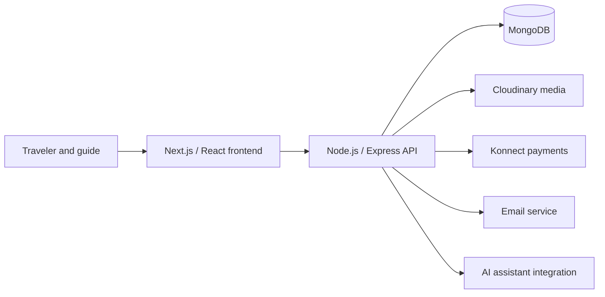

<div align="center">


# Guidini

### Discover local tours. Connect with guides. Plan experiences.

**A full-stack guided-tour discovery and management platform, developed as a collaborative final-year Computer Science project.**


</div>

---

## About the project

Guidini connects **travelers** looking for local experiences with **tour guides** offering tours and activities. It combines discovery, tour management, booking workflows, and communication in one web application.

The project was co-developed during a four-month final-year internship at **SW Consulting**, with contributions spanning frontend and backend development. The repository also contains experimental AI-assisted interaction and traveler-preference features.

## Key features

| Area | What the repository implements |
| --- | --- |
| **Tour and activity discovery** | Browse tours, activities, destinations, and guide profiles |
| **Tour guide workspace** | Guide profile management, tour listings, and reservation-related views |
| **Bookings** | Reservation routes, user/guide associations, and status management |
| **Payments** | Konnect payment-integration code and callback flows |
| **Messaging** | Conversation/message models and Socket.IO-related infrastructure |
| **Reviews and ratings** | Tour/guide feedback models and routes |
| **Personalization** | Traveler preference data and components for tailored discovery |
| **AI assistance** | Chatbot interface and backend route integrating Google Generative AI |
| **Media** | Cloudinary image-upload integration |

These are **implemented components and integrations**, not a claim that every external workflow has been independently validated in a production environment.

## Architecture



### Technologies

- **Frontend:** Next.js App Router, React, TypeScript, Tailwind CSS, and UI libraries.
- **Backend:** Node.js, Express, Mongoose, and Socket.IO.
- **Database:** MongoDB.
- **External services:** Cloudinary, Konnect, SendGrid, and Google Generative AI.
- **Other:** Map-oriented UI, authentication/JWT, and file uploads.

## Repository layout

```text
.
├── frontend/
│   ├── src/app/           # Pages, route handlers, and dashboards
│   ├── src/components/    # Reusable UI and chatbot components
│   └── public/            # Static images and branding
├── backend/
│   ├── controllers/       # API handlers
│   ├── models/            # MongoDB / Mongoose models
│   ├── routes/            # Express routes
│   ├── middleware/        # Authentication middleware
│   ├── config/            # Service integration
│   └── server.js
├── datasets/              # Tour and traveler data files
└── README.md
```

## Local setup

**Prerequisites:** Node.js with npm, access to MongoDB, and provider credentials for the external integrations you intend to use.

1. Clone the repository:

   ```bash
   git clone https://github.com/Azizfer/PFE-Project.git
   cd PFE-Project
   ```

2. Create local environment files from the sanitized templates:

   ```bash
   cp backend/.env.example backend/.env
   cp frontend/.env.example frontend/.env
   ```

   Set your own fresh credentials locally. **Never commit your actual `.env` files.**

3. Install dependencies and start the API:

   ```bash
   cd backend
   npm install
   npm run dev
   ```

4. In another terminal, start the frontend:

   ```bash
   cd frontend
   npm install
   npm run dev
   ```

5. Open **http://localhost:3000**.

> **Project status:** This is an academic/internship codebase, not a turnkey deployment. Some integrations and routes have environment-specific assumptions, including API host/port references. Setup and end-to-end flows have not been independently tested as part of this documentation update.

## Screenshots

Screenshots of the tourist-facing pages, guide dashboard, and tour-booking flow can be added here once captured from a running instance. The current repository does not include a curated screenshot gallery.

## Security and sharing

The public repository previously included tracked configuration files. Those files have been removed from the current source tree and replaced by example templates, but **removal does not erase older Git history or revoke credentials**. See [SECURITY.md](SECURITY.md) for the required follow-up actions.

## What this project taught me

- Collaborating on a multi-feature, full-stack application.
- Building data models and REST APIs for users, tours, and reservations.
- Integrating third-party services into real application workflows.
- Connecting frontend experiences to backend business processes.
- Exploring personalization and AI-assisted user interactions.

---

<div align="center">

**Collaborative final-year internship project · SW Consulting**

[Aziz Ferchichi](https://github.com/Azizfer) · [LinkedIn](https://www.linkedin.com/in/aziz-ferchichi-499742218)

</div>
